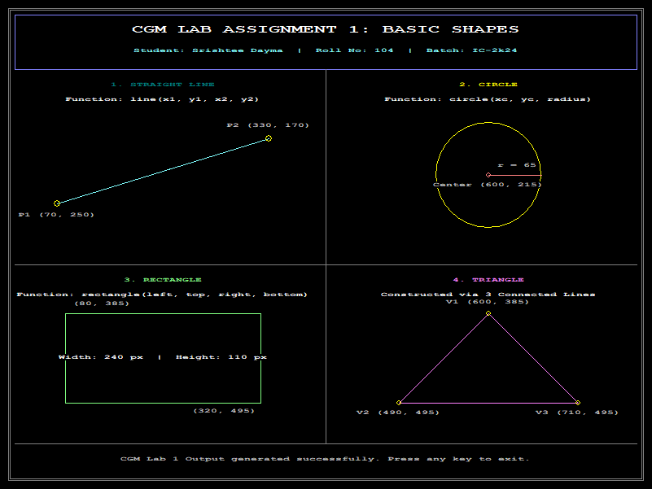

# CGM Lab Assignment 1: Basic Graphics Primitives

> **Course:** Computer Graphics & Multimedia Lab (CGM Lab)  
> **Student Name:** Srishtee Dayma  
> **Roll Number:** 104  
> **Batch:** IC-2k24  

---

## 📌 Problem Statement
Write a C/C++ program using a graphics library/tool to draw the following basic graphics primitives in a single program:
1. **A straight line**
2. **A circle**
3. **A rectangle**
4. **A triangle**

**Learning Objective:** To understand and implement basic graphics primitives using computer graphics programming.

---

## 🖼️ Program Output
Below is the screenshot of the output generated by the program, showing all four basic primitives rendered in a clean, labeled 4-quadrant layout:



---

## 📐 Primitives & Functions Used

| S.No. | Primitive | Function / Implementation | Parameters / Coordinates |
|:---:|:---|:---|:---|
| 1 | **Straight Line** | `line(x1, y1, x2, y2)` | $P_1(70, 250)$ to $P_2(330, 170)$ |
| 2 | **Circle** | `circle(xc, yc, radius)` | Center: $(600, 215)$, Radius: $r = 65$ |
| 3 | **Rectangle** | `rectangle(left, top, right, bottom)` | Top-Left: $(80, 385)$, Bottom-Right: $(320, 495)$ |
| 4 | **Triangle** | 3 Connected Lines (`line`) | Vertices: $V_1(600, 385)$, $V_2(490, 495)$, $V_3(710, 495)$ |

### Supporting Graphics Functions:
- `initwindow(width, height, title)`: Initializes the graphics window with specified dimensions and title.
- `setcolor(color)`: Sets current drawing color for boundaries and shapes.
- `setbkcolor(color)`: Configures the background color of the graphics viewport.
- `settextstyle(font, direction, charsize)`: Configures font family, orientation, and size for annotations.
- `settextjustify(horiz, vert)`: Sets alignment for rendered text strings.
- `outtextxy(x, y, text)`: Renders text at specified pixel coordinates $(x, y)$.
- `writeimagefile(filename)`: Exports the graphical framebuffer to an image file.
- `closegraph()`: Closes the graphics window and deallocates memory.

---

## 🛠️ Prerequisites & Compilation

### Requirements
- **OS:** Windows (7/10/11)
- **Compiler:** MinGW GCC/G++ (`g++`)
- **Graphics Library:** WinBGIm / BGI (`graphics.h`, `libbgi.a`)

### How to Compile and Run

#### Option 1: Using the automated batch script
Double-click or run:
```cmd
compile.bat
```

#### Option 2: Manual compilation with `g++`
Run the following command in PowerShell or Command Prompt:
```cmd
g++ assignment1_basic_shapes.cpp -o assignment1_basic_shapes.exe -lbgi -lgdi32 -lcomdlg32 -luuid -loleaut32 -lole32
```
Then execute:
```cmd
.\assignment1_basic_shapes.exe
```

---

## 📂 Repository Structure
```
├── assignment1_basic_shapes.cpp  # Main C++ source code drawing the 4 primitives
├── compile.bat                   # 1-click compilation and execution script
├── output.png                    # Screenshot of the output graphics window
└── README.md                     # Documentation, setup guide, and output preview
```
