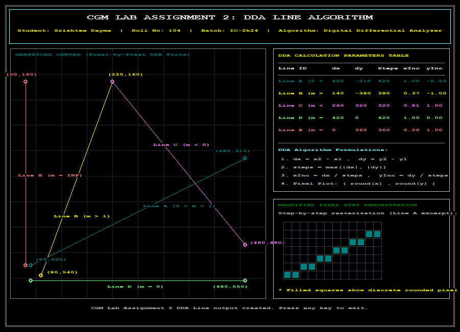

# 🖥️ CGM Lab Assignment 2: DDA Line Drawing Algorithm

> **Student Name:** Srishtee Dayma  
> **Roll Number:** 104  
> **Batch:** IC-2k24  
> **Course:** Computer Graphics & Multimedia Lab (CGM Lab)  
> **Language:** C++ (WinBGIm / `graphics.h`)  
> **Compiler:** MinGW GCC (`g++`)  

---

## 📌 Problem Statement & Objective

Write a C/C++ program using a graphics library (`graphics.h` / WinBGIm) to implement the **Digital Differential Analyzer (DDA) Line Drawing Algorithm**.

The program must:
1. Accept the starting point $(x_1, y_1)$ and ending point $(x_2, y_2)$.
2. Calculate the required rasterization steps using the DDA algorithm formulation.
3. Compute floating-point coordinate increments ($x_{inc}$ and $y_{inc}$).
4. Plot the line pixel-by-pixel using rounded integer coordinates `putpixel(round(x), round(y), color)`.
5. Display the output graphically with parameter readouts and slope test cases.

---

## 📐 Mathematical Formulation & Algorithm Theory

The **Digital Differential Analyzer (DDA)** is a scan-conversion line drawing algorithm based on computing either $\Delta x$ or $\Delta y$ using the differential equation of a straight line:

$$m = \frac{\Delta y}{\Delta x} = \frac{y_2 - y_1}{x_2 - x_1}$$

### Step-by-Step Mathematical Derivation

1. **Delta Calculation:**
   $$dx = x_2 - x_1$$
   $$dy = y_2 - y_1$$

2. **Step Determination:**
   To ensure smooth line rasterization without gaps, the total number of steps is chosen as the maximum absolute change between $x$ and $y$:
   $$\text{steps} = \max(|dx|, |dy|)$$

3. **Increment Calculation:**
   $$\Delta x_{inc} = \frac{dx}{\text{steps}}$$
   $$\Delta y_{inc} = \frac{dy}{\text{steps}}$$

4. **Slope Condition Analysis:**
   - **Case 1 ($|m| \le 1$):** $|dx| \ge |dy| \implies \text{steps} = |dx|$. Here, $x_{inc} = \pm 1$ and $y_{inc} = m$. $x$ increments by 1 unit per step while $y$ changes proportionally.
   - **Case 2 ($|m| > 1$):** $|dy| > |dx| \implies \text{steps} = |dy|$. Here, $y_{inc} = \pm 1$ and $x_{inc} = 1/m$. $y$ increments by 1 unit per step while $x$ changes proportionally.
   - **Case 3 (Horizontal, $m = 0$):** $dy = 0 \implies y_{inc} = 0, x_{inc} = 1$.
   - **Case 4 (Vertical, $m = \infty$):** $dx = 0 \implies x_{inc} = 0, y_{inc} = 1$.

5. **Pixel Rasterization Loop:**
   Start at $x = x_1, y = y_1$. For $i = 0$ to $\text{steps}$:
   $$\text{Plot Pixel at } (\text{round}(x), \text{round}(y))$$
   $$x = x + x_{inc}$$
   $$y = y + y_{inc}$$

---

## 📊 Calculated Parameters Table

The program tests 5 representative line conditions to validate the algorithm across all slope regimes:

| Line Tag | Condition | Start $(x_1, y_1)$ | End $(x_2, y_2)$ | $dx$ | $dy$ | Steps | $x_{inc}$ | $y_{inc}$ | Slope ($m$) | Color |
|:---|:---|:---:|:---:|:---:|:---:|:---:|:---:|:---:|:---:|:---:|
| **Line A** | Gentle Slope ($0 < m < 1$) | $(60, 520)$ | $(480, 310)$ | $420$ | $-210$ | $420$ | $1.00$ | $-0.50$ | $-0.50$ | Cyan |
| **Line B** | Steep Slope ($m > 1$) | $(80, 540)$ | $(220, 160)$ | $140$ | $-380$ | $380$ | $0.37$ | $-1.00$ | $-2.71$ | Yellow |
| **Line C** | Negative Slope ($m < 0$) | $(220, 160)$ | $(480, 480)$ | $260$ | $320$ | $320$ | $0.81$ | $1.00$ | $1.23$ | Magenta |
| **Line D** | Horizontal ($m = 0$) | $(60, 550)$ | $(480, 550)$ | $420$ | $0$ | $420$ | $1.00$ | $0.00$ | $0.00$ | Green |
| **Line E** | Vertical ($m = \infty$) | $(50, 160)$ | $(50, 520)$ | $0$ | $360$ | $360$ | $0.00$ | $1.00$ | $\infty$ | Red |

---

## 🖼️ Program Output Screenshot

Below is the output window produced by `assignment2_dda_line.cpp`:



---

## 💻 C++ Source Code Structure

- [`assignment2_dda_line.cpp`](./assignment2_dda_line.cpp): Core implementation containing the DDA line function `drawDDALine()`, mathematical readout panel, endpoint markers, and magnified pixel rasterization demonstration grid.

```cpp
DDAStats drawDDALine(const std::string& name, int x1, int y1, int x2, int y2, int color) {
    DDAStats stats;
    float dx = static_cast<float>(x2 - x1);
    float dy = static_cast<float>(y2 - y1);
    
    int steps = static_cast<int>(std::max(std::abs(dx), std::abs(dy)));
    float xInc = (steps == 0) ? 0.0f : dx / static_cast<float>(steps);
    float yInc = (steps == 0) ? 0.0f : dy / static_cast<float>(steps);

    float x = static_cast<float>(x1);
    float y = static_cast<float>(y1);

    for (int i = 0; i <= steps; ++i) {
        putpixel(static_cast<int>(round(x)), static_cast<int>(round(y)), color);
        x += xInc;
        y += yInc;
    }
    return stats;
}
```

---

## 🚀 How to Build and Run

1. Open Command Prompt in the `Lab2` directory:
   ```cmd
   cd Lab2
   ```
2. Run the provided batch file:
   ```cmd
   compile.bat
   ```
3. Alternatively, compile directly with MinGW GCC:
   ```cmd
   g++ assignment2_dda_line.cpp -o assignment2_dda_line.exe -lbgi -lgdi32 -lcomdlg32 -luuid -loleaut32 -lole32
   ```
4. Run the executable:
   ```cmd
   assignment2_dda_line.exe
   ```
